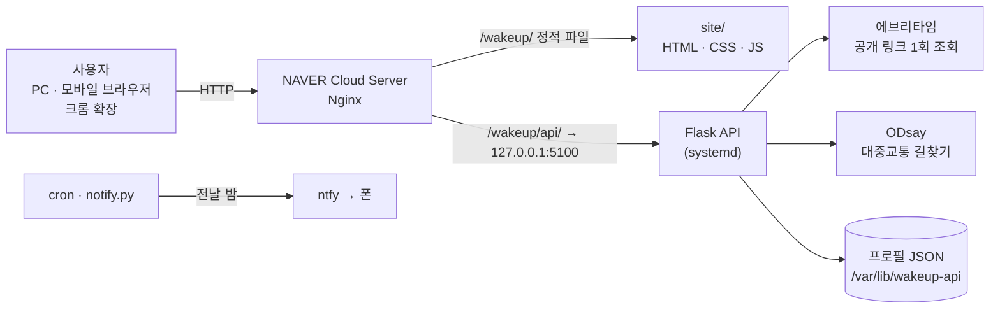

# 영남대 통학·수업 알리미

> 에브리타임 시간표를 한 번 등록하면, **아침에는 몇 시에 일어나야 하는지**, **낮에는 다음 수업까지 얼마나 남았는지** 알려 주는 웹 서비스

2026 NAVER Cloud Academy [특화] **Claude Code를 활용한 Agentic AI 과정** 팀 프로젝트 · 2026. 11.

      

> 데모 서버(네이버클라우드)는 과정이 끝나 종료되었습니다. 화면과 동작은 [발표 자료](<./영남대 통학·수업 관리 알리미.pdf>)에서 볼 수 있습니다.

---

## 왜 만들었나

| 상황 | 불편 |
|---|---|
| 아침 통학 | 요일마다 첫 수업 시각이 달라 기상·출발 시각을 매번 다시 계산함. 배차 간격이 긴 경산·대구 대중교통은 한 대만 놓쳐도 1교시 지각 |
| 공강 중 자습 | 도서관·카페에서 과제나 코딩에 몰입하다 다음 수업 시각을 놓침 |

공통 원인은 **"내 시간표 기준으로 지금 언제 움직여야 하는지"** 알려 주는 도구가 없다는 것입니다. 지도 앱은 매번 검색해야 하고, 시간표 앱은 통학 시간을 모르며, 해외 기상 알람 앱은 국내 대중교통과 학사 일정을 지원하지 않습니다.

## 핵심 기능

| 기능 | 설명 |
|---|---|
| **에타 링크로 시간표 등록** | 에브리타임 공개 공유 링크를 붙여 넣으면 과목·요일·시각·강의실만 가져옴. 미리보기 후 사용자가 저장해야 반영. 로그인·비밀번호 불필요 |
| **대시보드 + 수업 10분 전 알림** | 다음 수업 초 단위 카운트다운, 오늘 남은 수업, 주간 시간표. 수업 10분 전에는 화면 상단에 배너 표시 (같은 수업은 하루 한 번) |
| **요일별 기상·출발 시각** | 출발지만 입력하면 대중교통 소요 시간(ODsay 길찾기, 실패 시 대구 2호선 시각표)으로 요일별 기상·출발 시각 계산 |
| **크롬 확장 프로그램** | 툴바 미니 팝업으로 다음 수업 카운트다운 확인, 수업 5·10·15분 전 PC 알림 |
| **아이폰 단축어** | QR 한 번으로 요일별 기상 알람을 아이폰 시계 앱에 생성 |
| **전날 밤 알림** | 매일 밤 ntfy로 "내일 07:20 기상 · 08:05 출발"을 폰에 발송 |
| **무설치 동기화** | 회원가입 없이 8자리 코드로 PC·폰·크롬 확장 간 시간표 동기화 |

## 아키텍처



| 구분 | 사용 기술 |
|---|---|
| 프론트엔드 | 순수 HTML · CSS · JavaScript (외부 라이브러리·CDN 없음, QR 생성용 qrcode-generator만 서버에 포함) |
| 백엔드 | Python 3 · Flask (프로필 저장, 에타 가져오기, 길찾기 API) |
| 인프라 | NAVER Cloud Platform Server (Ubuntu) · Nginx 리버스 프록시 · systemd · cron |
| 확장 | Chrome Extension Manifest V3 (`chrome.alarms` · `chrome.notifications`) |
| 외부 연동 | 에브리타임 공개 시간표, ODsay 대중교통 API, ntfy |
| 테스트 | Node.js · Playwright(헤드리스 크롬) · Python unittest 스타일 스크립트 |

## Claude Code로 개발한 방식 (Agentic AI)

이 프로젝트의 코드는 팀원이 설계·검토하고 **Claude Code가 작성**했습니다. AI가 빠르게 만들되 위험한 일을 하지 않도록 아래 장치로 제어했습니다.

### 1. CLAUDE.md — AI 작업 규칙
[`CLAUDE.md`](./CLAUDE.md)에 프로젝트 규칙을 적어 모든 세션이 같은 기준으로 일하게 했습니다.

- **추측 금지**: 버스 시각·서버 IP처럼 확인되지 않은 값은 지어내지 않고 질문 목록에 추가
- **개인정보 금지**: 주소·좌표·이름·학번 필드를 만들지 않음, 통학은 걸리는 시간(분)만 저장
- **서버 안전**: 수정 전 백업, `rm -rf`·SSH·방화벽 변경 금지, Nginx는 `nginx -t` 통과 후에만 reload
- **설계 원칙**: 계산 로직(`calc.js` · `classes.js` · `commute.js`)은 DOM 없는 순수 함수로 유지하고, 규칙을 바꾸면 테스트도 함께 수정
- **Plan 모드**: 큰 작업은 설계안을 먼저 승인받은 뒤 구현

### 2. 커스텀 스킬 2종 — 반복 작업 자동화

| 스킬 | 하는 일 |
|---|---|
| [`/ext-check`](./.claude/skills/ext-check/SKILL.md) | 크롬 확장 7항목 점검(로직 테스트·JSON·JS 문법·파일 참조·외부 주소·서버 주소 일치) → 모두 통과할 때만 manifest 버전 자동 증가 → PC 반영 방법 안내 |
| [`/site-deploy`](./.claude/skills/site-deploy/SKILL.md) | 배포 전 사전 점검(외부 주소, 확장 zip 최신 여부) → `deploy.sh --check`로 바뀌는 파일 미리 보기 → **내가 고치지 않은 파일이 있으면 팀원 작업일 수 있어 배포 전에 사람에게 확인** |

두 스킬 모두 검사는 스크립트(`check.py` · `precheck.py`)가 하고, AI는 결과를 믿고 보고만 하도록 설계해 실행할 때마다 같은 결과가 나옵니다.

### 3. 안전한 팀 배포 — `deploy.sh`
세 명이 한 서버에 배포하면서 생긴 문제를 막기 위해 [`deploy.sh`](./deploy.sh)를 만들었습니다.

- **잠금(flock)**: 두 사람이 동시에 배포하면 뒤 사람은 멈춤
- **배포본 지문(sha256)**: 누군가 스크립트 밖에서 직접 바꿨으면 멈춤
- **`?v=` 검사**: JS·CSS를 바꾸고 캐시 버전을 안 올리면 멈춤
- **전체 테스트 통과 후에만 복사**, 배포마다 백업과 기록을 남김

결과: 팀원 3명이 5번 배포해 **5번 모두 테스트 통과 후 HTTP 200**

### 4. AI와 함께 해결한 문제

| 문제 | 해결 |
|---|---|
| 배포 후에도 브라우저가 예전 JS를 써서 에타 가져오기가 동작하지 않음 | 원인이 캐시임을 찾고 `?v=` 버전 규칙을 CLAUDE.md에 추가, `version.test.js`로 재발 방지 |
| 팀원이 동시에 배포해 서로의 변경을 덮어씀 | `deploy.sh`에 잠금·지문 검사 추가, `/site-deploy` 스킬로 연속 5회 무사고 배포 |
| 길찾기 API의 지하철역 ID가 맞지 않고, 주말에는 시연할 수업이 없음 | 역 이름 검색으로 바꿔 2호선 구간 해결, `?demo=9` 체험 모드로 요일과 관계없이 시연 |

## 품질

| 지표 | 결과 |
|---|---|
| 자동 테스트 | **560개 통과, 실패 0** (웹·서버 483 + 확장 77) |
| 모바일 | 360·400px에서 가로 스크롤 없음 등 46개 항목 |
| 알림 경계 | 10분 경계, 이미 시작한 수업 제외, 중복 알림 차단 |
| 예외 처리 | 에타 가져오기 실패 원인 6종 구분 안내, 네트워크 장애 시 시각표 대체·확장 오프라인 유지, 서버 데이터 크기 상한 |

## 보안 · 개인정보 설계

- **수집하지 않음**: 집 주소·이름·학번·전화번호. 출발지는 소요 시간 계산에만 쓰고 저장하지 않음
- **에타 계정 정보 미요구**: 공개 공유 링크만 1회 조회, 사용자 이름은 받지 않도록 요청
- **요청 한도**: 에타 가져오기 같은 IP 분당 10회, 길찾기 서버 전체 하루 300회
- **비밀 정보 격리**: API 키는 `.env`(커밋 제외)에서만 읽음
- **서비스 격리**: Flask는 `127.0.0.1`에서만 열리고 Nginx를 거쳐서만 접근, systemd 보호 설정(`ProtectSystem=strict` 등)으로 데이터 폴더 외 쓰기 차단

## 폴더 구조

```
site/        정적 웹 (대시보드 · 설정 · 첫 화면 · 계산 테스트 페이지)
  js/        time · calc · classes · commute · storage · bus · dashboard · setup ...
  data/      예시 시간표, 버스 노선, 대구 2호선 시각표
server/      Flask API (app.py · everytime.py · odsay.py · calc.py · notify.py),
             systemd 서비스 · cron 설정
extension/   크롬 확장 (MV3)
tests/       자동 테스트 (tests/README.md 참고)
ops/         Nginx 설정
docs/        기획서 · API 조사 · 발표 준비 문서 · 공공데이터 원본
.claude/     Claude Code 커스텀 스킬
CLAUDE.md    AI 작업 규칙
plan.md      개발 계획 (데이터 형식 · 경계 상황 · 단계별 확인 방법)
deploy.sh    팀 배포 스크립트
```

## 실행 방법

### 화면만 빠르게 보기 (서버 기능 제외)
```bash
cd site
python3 -m http.server 8000
# http://localhost:8000 → [예시 시간표로 체험]
```
예시 체험 모드와 기상 시각 계산은 동작합니다. 에타 가져오기·동기화·길찾기는 아래 서버 구성이 필요합니다.

### 서버 구성 (Ubuntu + Nginx)
```bash
# 1. 환경 변수 (커밋하지 않음)
echo "ODSAY_KEY=발급받은_키" > .env && chmod 600 .env

# 2. API 서버
sudo apt install -y python3-flask
sudo mkdir -p /var/lib/wakeup-api/profiles
sudo cp server/wakeup-api.service /etc/systemd/system/
sudo systemctl daemon-reload && sudo systemctl enable --now wakeup-api

# 3. Nginx: ops/default 의 /wakeup/api/ 프록시 설정 참고 → sudo nginx -t && sudo systemctl reload nginx

# 4. 웹 배포 (검사 · 테스트 · 백업 포함)
sh deploy.sh

# 5. (선택) 전날 밤 알림
sudo cp server/wakeup-notify.cron /etc/cron.d/wakeup-notify
```
`wakeup-api.service`의 경로(`/root/wakeup`)는 설치 위치에 맞게 바꿔 주세요.

### 테스트
```bash
sh tests/run-all.sh          # 전체 (모바일 화면 검사는 tests/README.md의 크롬 준비 필요)
python3 tests/test_import.py # 에타 가져오기만
node extension/test/schedule.test.js
```

## 한계와 향후 계획

| 현재 한계 | 향후 계획 |
|---|---|
| 시간표 기준 소요 시간이라 실시간 도로·버스 지연은 반영하지 않음 | 국토교통부 TAGO 및 대구·경산 실시간 버스 도착 API 연동 |
| 무료 API 한도 때문에 길찾기를 하루 300회로 제한 | 영남대 인근 정류장 목록 기반 간편 선택 UI |
| 공휴일·시험 기간 등 학사 일정 미반영, 수업 알림은 브라우저를 열어 둔 동안만 | 웹 대시보드와 크롬 확장의 시간 계산 로직을 하나의 모듈로 통합 |
| HTTP로 운영 (도메인 없음) | 도메인 연결 후 HTTPS 적용 |

## 팀

| 이름 | 역할 |
|---|---|
| 권기백 | 기획 · 주제 제안, Plan 모드로 CLAUDE.md 작업 규칙 설계, ODsay 길찾기 API 연동, 공공데이터포털 대구 도시철도 1·2·3호선 상·하선 시각표와 국토교통부(TAGO) 버스 API 연동 |
| 강민교 | 개발 |
| 김동준 | 개발 |
| 장우석 | PPT 제작 |
| 강명구 | 발표 |

## 데이터 출처 · 고지

- 대구 도시철도 시각표: 공공데이터포털 대구교통공사 1·2·3호선 상·하선 열차시각표 (`docs/data/`)
- 버스 정류장·도착 정보: 공공데이터포털 국토교통부(TAGO) 버스정류소정보·버스도착정보 API (`docs/bus-api-test.md`)
- 대중교통 길찾기: [ODsay LAB](https://lab.odsay.com/) API
- QR 생성: [qrcode-generator](https://github.com/kazuhikoarase/qrcode-generator) 2.0.4 (MIT)
- 에브리타임 연동은 학습 목적으로, 사용자가 직접 공개한 공유 링크만 1회 조회하며 원문을 저장하지 않습니다. 에브리타임과 무관한 비공식 프로젝트입니다.
